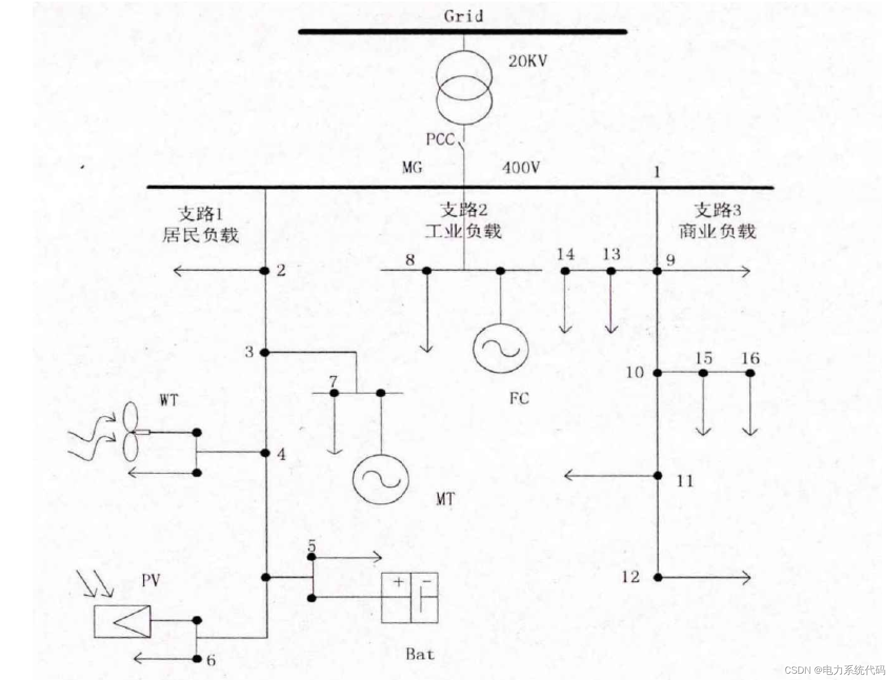
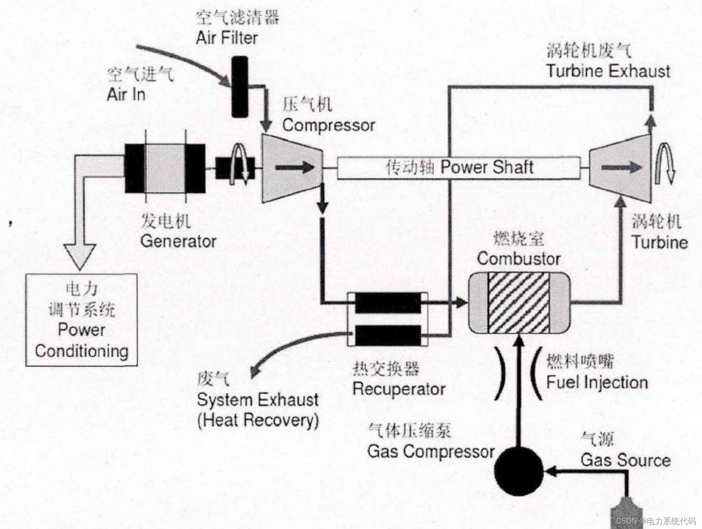
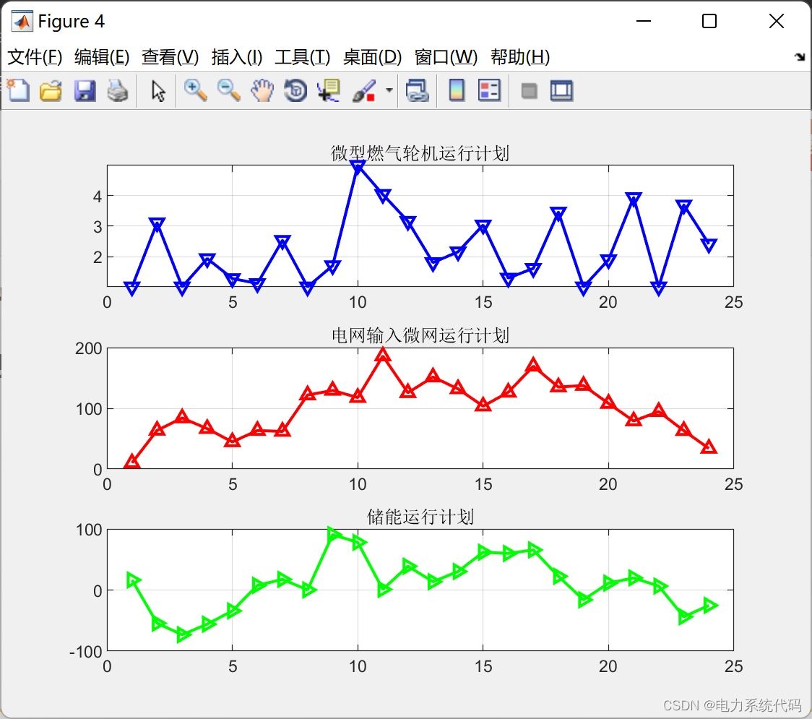
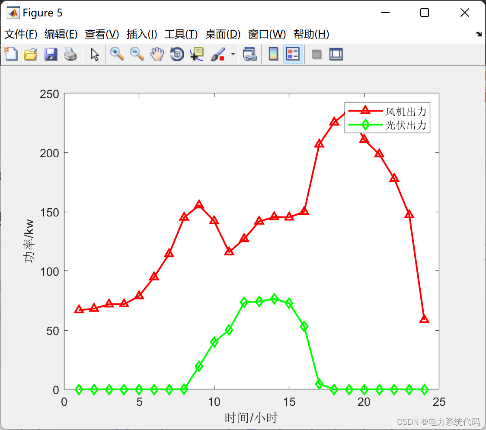
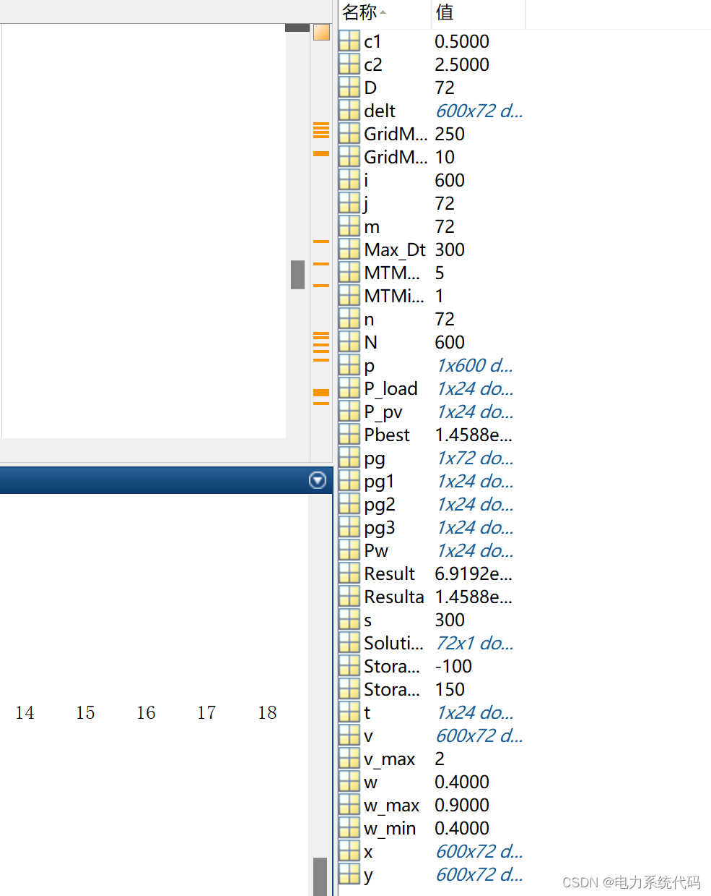

# MATLAB|Intelligent Microgrid Scheduling Based on Particle Swarm Optimization Algorithm (including wind, solar, micro-turbine, grid input microgrid, energy storage)

2 Simple Microgrid Structure Edit
3 Intelligent Microgrid Models 3.1 Micro-gas Turbine Power Generation Model A micro-gas turbine is a recently developed type of small thermal engine, with a single unit power generally ranging from 25 to 300 kilowatts. It boasts numerous advantages such as low consumption rate, low noise, low pollution, low maintenance rate, and remote diagnostic capabilities. In addition to being used for distributed power generation, it can also be utilized for standby power stations, combined heat and power (CHP) systems, etc., providing clean, reliable, high-quality multifunctional energy. Besides being used in central cities, it can also be effectively applied in remote areas and even in marginal regions.
The working principle of the micro-gas turbine is illustrated in the following diagram:
Edit
The working principle is as follows: The compressor compresses fresh air into high-pressure air, which is then preheated by the turbine in the heat exchanger. The preheated high-pressure air is fed into the fuel chamber to mix with fuel for combustion. The resulting high-temperature exhaust gas is sent to the turbine for work, while the generator's permanent magnet is driven by the turbine through the transmission shaft to generate electricity. Finally, the electric power regulation system converts the electrical energy generated by the generator's permanent magnets for use.
3.2 Energy Storage Device Models Photovoltaic and wind power, among other intermittent power sources, inherently exhibit randomness and fluctuations when connected to the main grid, posing potential risks to the operation of the main grid in terms of power balance, frequency stability, and voltage stability. Energy storage devices can adjust and reduce these phenomena. On the other hand, due to the relatively small output power of micro-gas turbines and fuel cells in distributed generation, they are more sensitive to fluctuations in individual loads. Considering system stability and safety, the microgrid system needs to be equipped with certain energy storage devices.
The main functions of energy storage devices include three aspects: firstly, to improve power quality and maintain system stability; secondly, to serve as backup power or to mitigate peak-shaving and valley-filling; thirdly, to bring certain economic benefits to individual distributed generation units. Up to now, there have been various energy storage methods, mainly divided into chemical and physical storage. Among them, nickel-metal hydride batteries (NiMH) are gaining popularity due to their high energy density, fast charging and discharging capabilities, long cycle life, and non-polluting characteristics. Research on enhancing the performance of NiMH batteries has never ceased.
For the charging and discharging of energy storage devices, due to the limitations of materials themselves, it is not possible to fully realize the conversion of energy.
This study is based on the operation of a microgrid system for one day, aiming to minimize the operational cost. For ease of analysis, the problem is divided into 24-hour segments, and it is assumed that the power output (input) of each device remains constant within each time segment.
The power at each minute mark is considered as the power of that period, forming the state space of the problem model. Therefore, the objective function is:
In which f(X) represents the cost function of the microgrid, where X denotes the state particles of the problem model; T represents the total time period for optimization scheduling; PG, PS, PGrid respectively represent the power generation of distributed power sources, batteries, and main grid at each moment; BG, BS, BGrid respectively represent the power generation costs of distributed power sources, energy storage devices, and main grid at each moment.
4.2 Constraints - Battery Capacity
Energy storage batteries must not only consider the power output (in) range limits during operation, but also constantly monitor the capacity constraints within the battery. Therefore, it is essential to meet:
0 \end{array}\right.">  
In the formula, represents the minimum capacity of the energy storage device, and represents the lowest point in the energy storage device.
Represents the maximum charging power and the maximum discharging power.
Power supply and demand balance
In the grid-connected mode, it is also necessary to ensure that all load demands within the microgrid can be met. Here, we consider a three-bus microgrid model with low voltage side, where power transmission losses are negligible and thus ignored. Therefore, it must be satisfied:
Where k represents the type of load in the microgrid at time t.
Then, there are limits for the power equipment, which are not shown here, as seen in the program.
5.2 Matlab Code: 5.1 Results Displaying
Edit
Edit
Edit
5.2 Matlab Code: This article only displays the main function code, all codes can be found in:
clear\nclc\nformat long;\n\n%% Initialization conditions\n%Maximum power of micro gas turbine\nMTMaxPower=5;\n% Minimum power of micro gas turbine\nMTMinPower=1;\n%Maximum power of microgrid input from the grid\nGridMaxImportPower=250;\n% The minimum power of the microgrid input to the grid\nGridMinImportPower=10;\n%Maximum Discharge Power of Energy Storage\nStorageMaxDischargingPower=150;\n%Maximum charging power for energy storage\nStorageMaxChargingPower=-100;\nP_load=[11.7 12.4 11.7 12.4 11.7 22.4 81.9 122.4 241.3 242.0 241.3 241.3 241.3 240.7 241.3 240.7 241.3 161.0 122.2 121.1 102.9 101.2 23.0 11.1];\nPw=[66.9\t68.2\t71.9\t72\t78.8\t94.8\t114.3\t145.1\t155.5\t142.1\t115.9\t127.1\t141.8\t145.6 145.3\t150\t206.9\t225.5\t236.1\t210.8\t198.6\t177.9\t147.2\t58.7];\nP_pv=[0 0 0 0 0 0 0 0.0391 19.5244 40.0204 50.1010 73.3946 74.3511 76.3489 72.8004 53.1185 4.6258 0 0 0 0 0 0 0];\nMax_Dt=300;%Maximum number of iterations 300\nD=72;% Search space dimension (number of unknowns)\nN=600;% Number of particles: 600\nw_max=0.9;\nw_min=0.4;\nv_max=2;\ns=1;\n\n%% Initialize the population of individuals (position and velocity)\nfor i=1:N\n    for j=1:72\n%         v(i,j)=randn;\n        v(i,j)=0.0;\n        if j<25\n            x(i,j)=MTMinPower+rand()*(MTMaxPower-MTMinPower);\n        elseif j>24&&j<49\n            x(i,j)=GridMinImportPower+rand()*(GridMaxImportPower-GridMinImportPower);\n        elseif j>48&&j<73\n            x(i,j)=StorageMaxChargingPower+rand()*(StorageMaxDischargingPower-StorageMaxChargingPower);\n        end\n    end    \nend\n\n%% Calculate the fitness of each particle and initialize Pi and Pg.\nfor i=1:N\n    p(i)=fitness(x(i,:),s);\n    y(i,:)=x(i,:);% Individual optimization value of each particle\nend\nPbest=fitness(x(1,:),s);\npg=x(1,:);%Pg is the global optimal solution.\nfor i=2:N\n    if fitness(x(i,:),s)<fitness(pg,s)\n       Pbest=fitness(x(i,:),s);\n       pg=x(i,:);% Global Optimal Update\n    end\nend\n\n%% Entering the main loop\nfor t=1:Max_Dt\n    for i=1:N\n        w=w_max-(w_max-w_min)*t/Max_Dt;% Inertia weight update\n        c1=(0.5-2.5)*t/Max_Dt+2.5; % Cognition\n        c2=(2.5-0.5)*t/Max_Dt+0.5; %Social Understanding\n%         w=0.7;\n%         c1=2.05; % cognition\n%         c2=2.05; % social recognition\n        v(i,:)=w*v(i,:)+c1*rand()*(y(i,:)-x(i,:))+c2*rand()*(pg-x(i,:));\n        for m=1:72\n            if(v(i,m)>v_max)\n                v(i,m)=v_max;\n            elseif(v(i,m)<-v_max)\n                v(i,m)=-v_max;\n            end\n        end\n        \n        x(i,:)=x(i,:)+v(i,:);\n        % Handle particle boundary processing\n        for n=1:72\n            if n<25\n                   if x(i,n)<MTMinPower\n                         x(i,n)=MTMinPower;\n                         v(i,n)=-v(i,n); \n                   elseif x(i,n)>MTMaxPower\n                         x(i,n)=MTMaxPower;\n                         v(i,n)=-v(i,n); \n                   else\n                         delt(i,n)=0;\n                   end\n            elseif n>24&&n<49\n                    if x(i,n)<GridMinImportPower\n                         x(i,n)=GridMinImportPower;\n                         v(i,n)=-v(i,n);  \n                   elseif  x(i,n)>GridMaxImportPower\n                         x(i,n)=GridMaxImportPower;\n                         v(i,n)=-v(i,n);                     \n                    else\n                         delt(i,n)=0;\n                    end\n            else\n                    if x(i,n)<StorageMaxChargingPower\n                          x(i,n)=StorageMaxChargingPower;\n                          v(i,n)=-v(i,n); \n                   elseif x(i,n)>StorageMaxDischargingPower\n                        x(i,n)=StorageMaxDischargingPower;\n                        v(i,n)=-v(i,n); \n                    else\n                        delt(i,n)=0;\n                    end\n            end\n        end \n        % Evaluate particles and find the optimal value\n        if fitness(x(i,:),t)<p(i)\n            p(i)=fitness(x(i,:),t);\n            y(i,:)=x(i,:);\n        end\n        if p(i)<Pbest\n            Pbest=p(i);\n            pg=y(i,:);\n            s=t;\n        end\n    end \n    %Pbest(t)=fitness(pg,s);\nend\n\ndisp('*************************************************************')\n\ndisp('The global optimal position of the function is: ')\n\nSolution=pg'\nfor m=1:24\n    pg1(m)=pg(m);\nend\nfor m=25:48\n    pg2(m-24)=pg(m);\nend\nfor m=49:72\n    pg3(m-48)=pg(m);\nend\n%% Visualization\nfigure\nt=1:24\nsubplot(311)\nplot(t,pg1,'Color','b','Marker','v','LineWidth',1.5)\ngrid\ntitle('Micro-gas turbine operation plan')\nsubplot(312)\n  
​  

## Images

<!-- PAYMENT_BLOCK -->

## Get this dataset

- Payment link (Stripe): [Buy now](https://buy.stripe.com/3cs8yP7sY87d0vu9AB)
- Payment QR code: 

<!-- /PAYMENT_BLOCK -->
